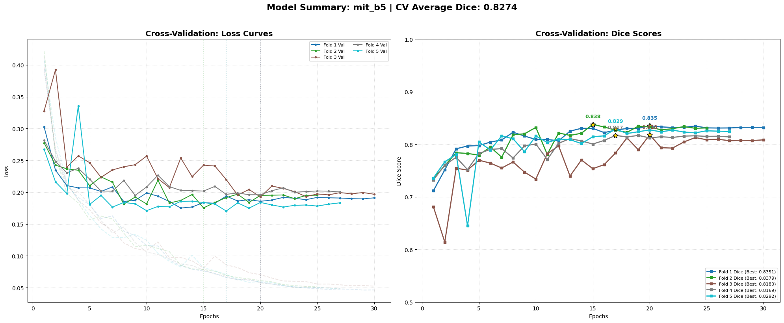

# Road Pothole Segmentation — Data Science ARA 7.0 (ITS, 2026)

Binary semantic segmentation of potholes in road photos: for every test image, predict which pixels belong to a pothole. Built for Data Science ARA 7.0, a Kaggle competition run by ARA at Institut Teknologi Sepuluh Nopember (ITS), as team **Analyx**. Final result: **8th on the private leaderboard** (Dice 0.80370).

The solution fine-tunes a SegFormer with a MiT-B5 encoder, trains one model per fold in 5-fold cross-validation, and averages the five models plus a horizontal-flip TTA at inference.

| | |
|---|---|
| Task | Binary segmentation (pothole vs. background) |
| Data | 498 labelled training images with masks, 295 test images |
| Metric | Dice |
| 5-fold CV Dice (mean of best epochs) | 0.827 |
| Public leaderboard (about 30% of test) | 0.77005, 27th |
| Private leaderboard (about 70% of test, final) | **0.80370, 8th** |
| Submission format | Run-length encoded masks (`ImageId`, `rle`) |

The competition dataset is not included in this repository.

## Approach

**Model.** `smp.Segformer` (segmentation-models-pytorch) with an ImageNet-pretrained `mit_b5` encoder and one output channel. Images are resized to 512×512.

**Loss.** `0.7 × Tversky + 0.3 × BCE`, with Tversky `alpha=0.3, beta=0.7`. Pothole pixels cover a median 9% of a training image, and under 1% in the tenth of images with the smallest potholes, so the Tversky term penalises missed pothole pixels (false negatives) more than false alarms. BCE is kept as a smaller term for stable gradients.

**Training.** 5-fold `KFold(shuffle=True, random_state=42)`. Per fold: AdamW (lr 2e-4), cosine annealing over 30 epochs, mixed precision, batch size 4. The checkpoint with the best validation Dice is kept, and training stops after 10 epochs without improvement.

**Augmentation.** Training: `RandomResizedCrop` (scale 0.7–1.0), horizontal flip, `ShiftScaleRotate` (shift 0.1, scale 0.1, rotate 15°), `RandomBrightnessContrast`. Validation and test: resize and normalise only.

**Inference.**
1. Run each of the five fold models on the original image and on its horizontal flip, then flip the second prediction back.
2. Average the ten probability maps and resize to the original image size.
3. Threshold at 0.5, remove connected regions under 150 pixels, then apply a morphological closing with a disk of radius 3.
4. Encode each mask as RLE (column-major) for the submission CSV.

## Results

| Leaderboard | Dice | Rank |
|---|---|---|
| Public (about 30% of test images) | 0.77005 | 27 |
| Private (about 70%, final standings) | 0.80370 | 8 |

The team made 34 submissions in total. The team moved from 27th on the public split to 8th on the private split; with only about 89 images in the public split, public ranks were a weak guide.

Best validation Dice per fold, taken from the training log in the notebook:

| Fold | Best val Dice | Best epoch | Stopped at epoch |
|---|---|---|---|
| 1 | 0.8351 | 20 | 30 |
| 2 | 0.8379 | 15 | 25 |
| 3 | 0.8180 | 20 | 30 |
| 4 | 0.8169 | 17 | 27 |
| 5 | 0.8292 | 17 | 27 |
| **Mean** | **0.8274** | | |



Validation Dice here is computed on single predictions (no TTA, no post-processing), with a 0.5 threshold, per batch of 4 images and then averaged over batches.

## Limitations

- **The CV score is optimistic.** Each fold reports the Dice of the epoch chosen on that same validation fold, and there is no separate hold-out set.
- **The validation Dice is not the competition metric as implemented.** It pools pixels over a batch of 4 images, while a per-image Dice would weight small potholes more. Treat 0.827 as an internal number: the leaderboard scores (0.770 public, 0.804 private) sit below it.
- **The inference steps were never scored on validation data.** TTA, the 5-fold average, the 0.5 threshold, the 150-pixel filter and the closing radius were set by hand, so their individual effect is unknown.
- **No ablations.** The notebook does not compare SegFormer with a U-Net, Tversky with plain Dice or BCE, or MiT-B5 with smaller encoders. The choices are reasonable defaults for small, imbalanced masks, not proven winners on this data.
- **The split is random.** If several photos show the same stretch of road, they can fall into different folds and inflate CV. This was not checked.
- **One training run.** Seeds fix the fold split and the Python, NumPy and PyTorch generators, but cuDNN is not set to deterministic mode, so a rerun will not match the log exactly.
- **Package versions were not recorded.** With current releases the code runs but warns: `ShiftScaleRotate` is deprecated in albumentations 2.x, and `binary_closing` disappears in scikit-image 0.28 (hence the pin).

## Repository structure

```
notebooks/ara-pothole-segformer-mitb5.ipynb   training, CV plot, inference, submission
assets/cv_curves.png                          loss and Dice curves exported from the notebook
requirements.txt                              packages on top of Kaggle's PyTorch
```

## How to run

The notebook was run on Kaggle with one NVIDIA Tesla T4. The training log and CV plot in the notebook are the outputs of that run; the figure that showed predictions on test images was removed because it contains competition images.

1. Get the dataset from the competition organiser and extract it so that the folder looks like this:
   ```
   <DATA_DIR>/train/images/   train_001.jpg ...
   <DATA_DIR>/train/mask/     mask_001.png ...  (0 = background, 255 = pothole)
   <DATA_DIR>/test/images/
   ```
2. On Kaggle, attach the dataset as `dataset-ara`, which matches the default path. Elsewhere, set `ARA_DATA_DIR=<DATA_DIR>`.
3. Install the packages in `requirements.txt` (the first notebook cell does this on Kaggle) and run all cells. Training five MiT-B5 folds needs a GPU.

Output: `best_model_fold{0..4}.pth` and `submission_mitb5_tta.csv`.

## Team and credits

Team **Analyx**, three members. Each member trained their own models and the team submitted whichever scored best. This notebook is my work (Vincent Osbert) and produced the team's best leaderboard score: data pipeline, model and loss choice, 5-fold training, TTA ensemble, post-processing and RLE submission.

The competition, data and leaderboard belong to the Data Science ARA 7.0 organisers at ITS.
